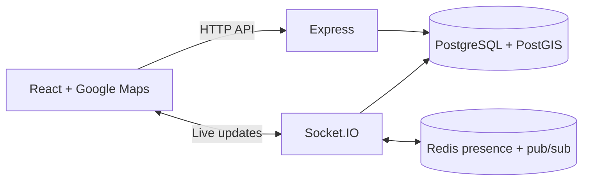

<div align="center">

# The Marauder’s Map

**“I solemnly swear that I am up to no good.”**

A real-time location-sharing app that brings the Marauder’s Map to the real world: parchment streets, named footsteps, and a map you reveal with an oath.

[**Open the live map ↗**](https://marauders-map-sigma.vercel.app/) · [Run locally](docs/setup.md) · [Deployment](docs/deployment.md) · [Contribute](CONTRIBUTING.md)


</div>

## A little mischief, mapped

Reveal the parchment, create an account, and allow location access to see your own footsteps. Sharing starts off. Choose **Share with everyone on this map** to appear on other people’s maps, and **Stop sharing my location** to turn it off.

To try it with someone else, open the live site on two devices, sign in with different accounts, and enable sharing on both. **Show everyone** fits visible users on the map; selecting a name brings that person into view.

## What’s inside

- Animated parchment reveal and themed sign-in.
- Google Maps with custom styling and landmark labels.
- Named footsteps driven by browser geolocation.
- Authenticated Socket.IO connections for live updates.
- Account-level sharing controls and multi-device sessions.
- Reconnection snapshots and a short offline grace period.

The interface offers sharing with everyone or turning sharing off. Friends-only visibility exists in the backend, but a friend-management interface is not implemented.

## Screenshots

See the [capture guide](docs/screenshots/README.md) to add screenshots. The embeds below are ready to enable once the files are added.

<!-- Add the actual images before uncommenting this block.


| Sign in | Live footsteps |
| --- | --- |
|  |  |
-->

## Run it locally

You need **Node.js 22.12+**, npm, Docker Desktop (or PostgreSQL with PostGIS and Redis), and a Google Maps browser key.

> This checkout has known location-write/schema inconsistencies. These instructions start the app, but live sharing needs the [current issues](docs/troubleshooting.md#current-location-sharing-limitations) resolved. The deployment may use a different schema or revision.

### 1. Clone and configure

```sh
git clone https://github.com/shivanip11/marauders-map.git
cd marauders-map
```

Copy the templates:

```powershell
# Windows PowerShell
Copy-Item client/.env.example client/.env
Copy-Item server/.env.example server/.env
```

```sh
# macOS / Linux
cp client/.env.example client/.env
cp server/.env.example server/.env
```

Add your Maps key to `client/.env` and replace `JWT_SECRET` in `server/.env`. Leave `VITE_API_URL` empty locally.

### 2. Start PostgreSQL and Redis

With Docker’s engine running, from the repository root:

```sh
docker compose up -d --wait
```

A new PostgreSQL volume is initialized with PostGIS and the base schema. See [Troubleshooting](docs/troubleshooting.md) if ports 5432 or 6379 are already occupied.

### 3. Start both apps

Use **two separate terminals**, starting from the repository root:

```sh
# Terminal 1 — backend
cd server
npm ci
npm run dev
```

```sh
# Terminal 2 — frontend
cd client
npm ci
npm run dev
```

Open **http://localhost:5173**. The backend runs at **http://localhost:4000**; Vite forwards `/api` and `/socket.io` to it.

For Google Maps configuration, setup without Docker, and testing on your phone, follow the [full setup guide](docs/setup.md).

## How it fits together



| Layer | Tools | Purpose |
| --- | --- | --- |
| Frontend | React, Vite, Google Maps | Map, account forms, geolocation |
| Backend | Node.js, Express, Socket.IO | Accounts, sharing settings, live events |
| Database | PostgreSQL, PostGIS | Users, sessions, permissions, latest positions |
| Presence | Redis, Socket.IO Redis adapter | Presence keys and events across backend instances |
| Authentication | JWT, bcrypt | Signed sessions and password hashing |

## Repository guide

```text
client/                   React app and Vite configuration
  .env.example            Browser configuration
  src/components/         Reveal, sign-in, map, markers
  src/hooks/              Geolocation and socket lifecycle
server/                   Express and Socket.IO backend
  .env.example            Database, Redis, authentication settings
  db/                     Base schema and alternate location-table SQL
  src/config/             Database and Redis clients
  src/sockets/            Location updates and presence
  test/                   Sharing integration test
docs/                     Setup, deployment, troubleshooting, screenshots
compose.yaml              Local PostgreSQL/PostGIS and Redis
```

## Development commands

| Directory | Command | Purpose |
| --- | --- | --- |
| `client` | `npm run dev` | Frontend on port 5173 |
| `client` | `npm run build` | Production bundle in `client/dist` |
| `client` | `npm run preview` | Build preview; no development API proxy |
| `client` | `npm run lint` | Oxlint |
| `server` | `npm run dev` | Backend with nodemon |
| `server` | `npm start` | Backend without file watching |
| `server` | `npm run test:integration` | Sharing checks; see [requirements](CONTRIBUTING.md#validation) |

## More documentation

- [Setup and environment reference](docs/setup.md)
- [Deployment and routing](docs/deployment.md)
- [Troubleshooting](docs/troubleshooting.md)
- [Contributing](CONTRIBUTING.md)
- [Adding screenshots](docs/screenshots/README.md)

## Credits

Inspired by the Marauder’s Map from Harry Potter. This independent fan project is not affiliated with the rights holders. Map services are provided by Google Maps Platform.

No project license is currently included in this repository.
